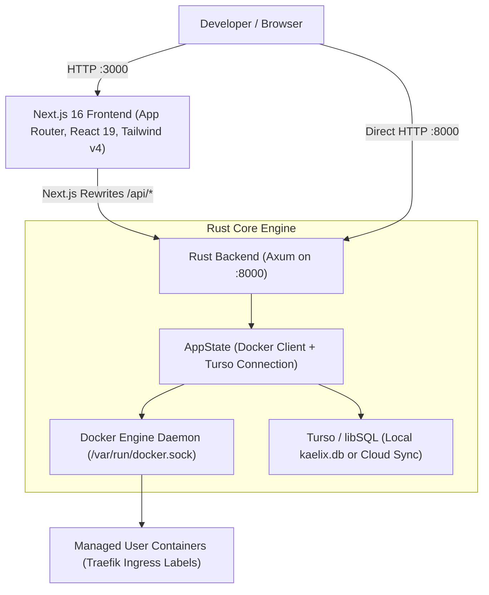
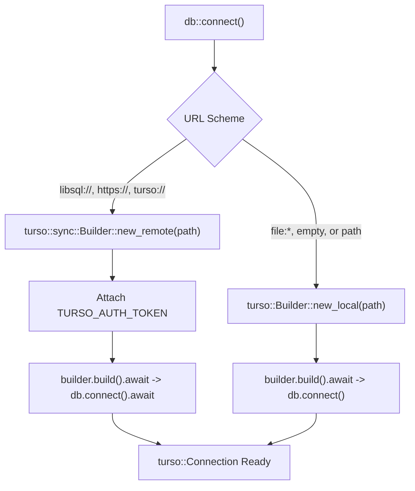

# Kaelix: Architecture & Technical Documentation

> **Kaelix** is a lightweight, self-hosted container deployment control plane built with **Rust (Axum)**, **Next.js 16**, and **Turso (libSQL)**. It provides a quiet, developer-friendly interface for managing containerized workloads, routing them through Traefik, and monitoring infrastructure status.

---

## 1. System Architecture



### Request Flow
1. **Frontend Request**: The user opens `http://localhost:3000`.
2. **Proxy Rewrites**: `JS/next.config.ts` proxies requests matching `/api/:path*` to `http://localhost:8000/:path*`.
3. **Health & Status Polling**:
   - `/api/up` $\rightarrow$ Checks database connectivity with `SELECT 1` via `Rust/src/routes/up.rs`.
   - `/api/version` $\rightarrow$ Queries Docker engine details (version, API version, OS, arch) via `Rust/src/routes/version.rs`.
4. **Dashboard Render**: The frontend displays real-time status badges for **Turso** and the **Docker Engine**.

---

## 2. Backend Architecture (`Rust/`)

The backend is built with **Axum 0.8** on top of **Tokio** and **Tower**.

### 2.1 State Management (`src/state.rs`)
```rust
#[derive(Clone)]
pub struct AppState {
    pub docker: Docker,
    pub db: Connection,
}
```
- Both `bollard::Docker` and `turso::Connection` maintain internal reference-counted handles (`Arc`).
- The entire `AppState` is cheaply cloneable across Axum worker threads without requiring external mutex locks around the database client.

### 2.2 Entrypoint & Middleware (`src/main.rs`)
- **Structured Tracing**: Uses `tracing_subscriber` with compact formatting.
- **Docker Client**: Connects via `Docker::connect_with_local_defaults()` using the host Docker socket (`/var/run/docker.sock`).
- **Database Bootstrapping**: Calls `db::connect().await` and executes embedded migrations prior to serving traffic.
- **HTTP Middleware**: Wraps all requests with `tower_http::trace::TraceLayer` to log spans and HTTP response codes.
- **Listener**: Binds to `0.0.0.0:8000`.

### 2.3 Database Layer (`src/db.rs`)
Uses the official `turso` crate (`0.8.3`) with `sync` enabled.



- **Dual-Mode Connectivity**:
  - **Local Mode**: Uses `turso::Builder::new_local("kaelix.db")`. No external server required.
  - **Remote Cloud Sync Mode**: Uses `turso::sync::Builder::new_remote(...)` with `TURSO_AUTH_TOKEN`.
- **Embedded Migration Runner**:
  - Embeds `migrations/0001_create_deployments.sql` into the binary using `include_str!`.
  - Maintains an internal `_migrations` tracking table so migrations execute once and remain idempotent.
- **Automated Recompilation** (`build.rs`):
  - Declares `cargo:rerun-if-changed=migrations` to ensure Cargo re-embeds SQL changes automatically.

### 2.4 Workload & Docker Orchestration (`src/docker.rs`)
Direct container runtime interface using `bollard`:
- **`pull_image(docker, image, tag)`**: Streams image download progress chunk-by-chunk from Docker registries.
- **`create_container(docker, image, name, domain, port)`**: Creates containers attached to the `kaelix-net` bridge network and injects Traefik ingress labels:
  - `traefik.enable=true`
  - `traefik.http.routers.<name>.rule=Host(<domain>)`
  - `traefik.http.routers.<name>.entrypoints=web`
  - `traefik.http.services.<name>.loadbalancer.server.port=<port>`
- **`start_container(docker, name)`**: Starts the created container.

### 2.5 API Endpoints (`src/routes/`)
| Method | Route | Handler | Purpose |
| :--- | :--- | :--- | :--- |
| `GET` | `/` | `root::root` | Returns `{"hello": "world"}` JSON. |
| `GET` | `/up` | `up::health_check` | Pings Turso database with `SELECT 1`. Returns `200 OK` or `503 Service Unavailable`. |
| `GET` | `/version` | `version::get_version` | Queries Docker daemon and returns version, API version, OS, and architecture. |

### 2.6 Data Schema (`migrations/0001_create_deployments.sql`)
```sql
CREATE TABLE IF NOT EXISTS deployments (
    id         INTEGER PRIMARY KEY AUTOINCREMENT,
    name       TEXT NOT NULL UNIQUE,              -- Container name
    image      TEXT NOT NULL,                     -- Docker image repository
    tag        TEXT NOT NULL DEFAULT 'latest',    -- Image tag
    domain     TEXT NOT NULL UNIQUE,              -- Traefik Host routing rule
    port       INTEGER NOT NULL CHECK (port BETWEEN 1 AND 65535),
    status     TEXT NOT NULL DEFAULT 'created'
               CHECK (status IN ('created', 'starting', 'running', 'stopped', 'failed')),
    created_at TEXT NOT NULL DEFAULT (CURRENT_TIMESTAMP),
    updated_at TEXT NOT NULL DEFAULT (CURRENT_TIMESTAMP)
);
```

---

## 3. Frontend Architecture (`JS/`)

Built with **Next.js 16 (App Router)**, **React 19**, and **Tailwind CSS v4**.

### 3.1 Styling & Design System (`app/globals.css`)
- Custom dark control-surface aesthetic with subtle borders and typography.
- Built-in Geist Sans & Geist Mono font integration via `app/layout.tsx`.

### 3.2 Real-time Dashboard (`app/page.tsx`)
- **Live Health Polling**: Concurrent status check on `/api/up` and `/api/version` using `Promise.allSettled`.
- **Status Cards**:
  - **Turso Database**: Displays connectivity status (`reachable` vs `awaiting connection`) with live state badges.
  - **Docker Engine**: Displays runtime details (e.g., `v29.5.3`, `linux / arm64`).
- **Workloads Section**: Prepared empty-state UI for container deployments.
- **Manual Refresh**: Dedicated refresh control to re-trigger health probes.

### 3.3 Next.js Configuration (`next.config.ts`)
Configured for standalone output with dynamic API proxying:
```typescript
async rewrites() {
  return [
    {
      source: "/api/:path*",
      destination: `${process.env.API_URL ?? "http://localhost:8000"}/:path*`,
    },
  ];
}
```

---

## 4. Development Workflow & Tooling

### 4.1 Single-Command Startup (`dev.sh`)
The `dev.sh` script manages full lifecycle orchestration without requiring Docker Compose:

```bash
./dev.sh
```

**Workflow stages in `dev.sh`**:
1. **Root Resolution**: Sets working directory to repository root regardless of where invoked.
2. **Environment Bootstrapping**: Generates `.env` from `.env.example` if missing, then exports all variables.
3. **Runtime Detection**: Autodetects `bun` (preferred) or `npm`.
4. **Port Reclamation**: Checks ports `8000` and `3000` using `lsof` and terminates stale processes before launch.
5. **Concurrent Execution**: Launches `Rust` (`cargo run`) and `JS` (`bun dev`) as background jobs.
6. **Trap Management**: Traps `SIGINT`/`SIGTERM`/`EXIT` (`Ctrl+C`) to cleanly terminate both child process trees.

### 4.2 Environment Configuration (`.env.example`)
```env
# Turso Database
# For Turso Cloud:
# TURSO_DATABASE_URL=libsql://your-db-name.turso.io
# TURSO_AUTH_TOKEN=your-turso-auth-token
# For local SQLite/libSQL:
TURSO_DATABASE_URL=file:kaelix.db

# Ports & Logging
BACKEND_PORT=8000
FRONTEND_PORT=3000
RUST_LOG=kaelix=info,tower_http=info
```

---

## 5. CI/CD Pipeline (`.github/workflows/ci.yml`)

The GitHub Actions workflow triggers on pushes and PRs to `main`:

1. **Backend Job**:
   - Sets up stable Rust (`clippy`, `rustfmt`).
   - Caches cargo registry and build cache via `Swatinem/rust-cache`.
   - Runs `cargo fmt --check`, `cargo clippy -- -D warnings`, and `cargo build`.
2. **Frontend Job**:
   - Sets up Bun via `oven-sh/setup-bun`.
   - Caches `JS/node_modules` based on `bun.lock`.
   - Runs `bun install --frozen-lockfile`, `bun run lint`, and `bun run build`.
3. **Docker Verification Job**:
   - Validates standalone image buildability:
     - `docker build ./Rust`
     - `docker build ./JS`

---

## 6. Complete Project File Inventory

```
kaelix/
├── .github/
│   └── workflows/
│       └── ci.yml               # Automated CI (Rust test/lint, Bun test/build, Docker build)
├── JS/                          # Next.js App Router Frontend
│   ├── app/
│   │   ├── globals.css          # Design system & dark theme styles
│   │   ├── layout.tsx           # Root layout with Geist fonts & metadata
│   │   └── page.tsx             # System dashboard & service health cards
│   ├── public/                  # SVG icons & static assets
│   ├── Dockerfile               # Multi-stage production container build
│   ├── bun.lock                 # Bun dependency lockfile
│   ├── eslint.config.mjs        # ESLint flat config
│   ├── next.config.ts           # API rewrite proxy rules & standalone build
│   ├── package.json             # Next.js 16, React 19, Tailwind v4
│   ├── postcss.config.mjs       # Tailwind CSS PostCSS plugin
│   └── tsconfig.json            # TypeScript configuration
├── Rust/                        # Axum Backend Engine
│   ├── migrations/
│   │   └── 0001_create_deployments.sql # Deployments table schema
│   ├── src/
│   │   ├── routes/
│   │   │   ├── root.rs          # GET / handler
│   │   │   ├── up.rs            # GET /up database ping health check
│   │   │   └── version.rs       # GET /version Docker daemon inspector
│   │   ├── db.rs                # Turso connection builder, migration runner & tests
│   │   ├── docker.rs            # Bollard client: pull, create (Traefik labels), start
│   │   ├── main.rs              # Axum server setup, tracing, route binding
│   │   ├── routes.rs            # Route module declarations
│   │   └── state.rs             # Shared AppState definition
│   ├── build.rs                 # Migration file change detection trigger
│   ├── Cargo.lock               # Rust crate dependency lockfile
│   ├── Cargo.toml               # Crate dependencies: axum, turso, bollard, tokio, tower
│   └── Dockerfile               # Multi-stage Rust release container build
├── .env.example                 # Environment template
├── .gitignore                   # Ignore rules for cargo, target, .next, *.db
├── README.md                    # Project overview & getting started guide
├── DOCUMENTATION.md             # Complete project architecture & technical docs
└── dev.sh                       # Single-command dev environment runner
```
